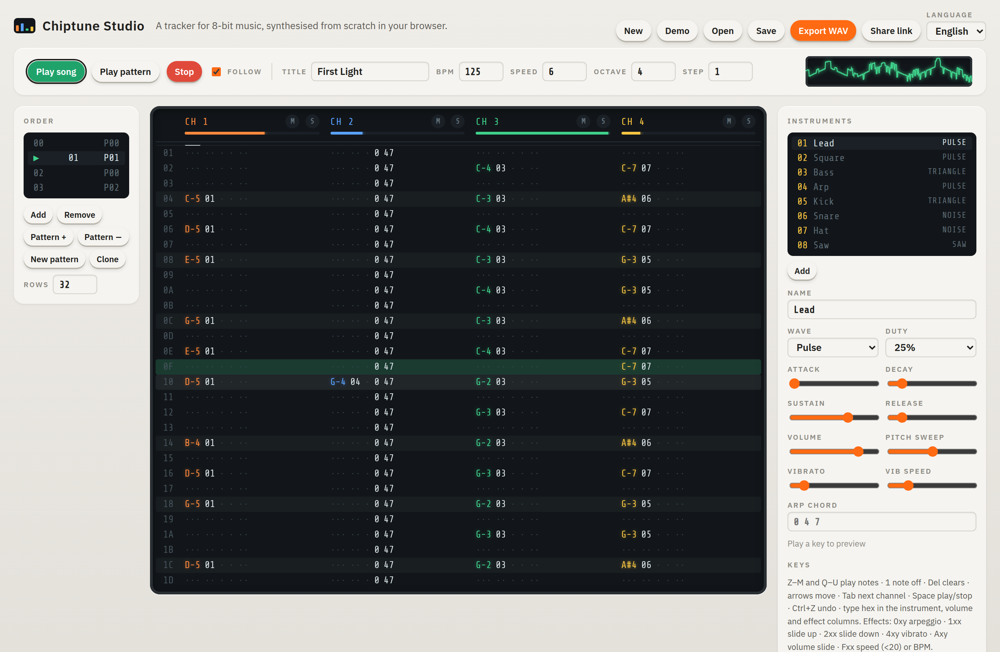

<h1 align="center">Chiptune Studio</h1>

<p align="center">
  <b>A tracker for 8-bit music, synthesised from scratch in your browser.</b><br>
  Four channels of pulse, saw, 4-bit triangle and LFSR noise from a hand-written synth engine, a keyboard-driven
  pattern editor, instruments with envelopes, classic tracker effects, live playback in an AudioWorklet and a WAV
  export that runs the very same code. Songs travel as a single link.
</p>

<p align="center">
  
</p>

**Live:** https://ardakalper.github.io/chiptune-studio/

## Features

- **A synth engine written by hand, no samples and no Web Audio oscillators.**
  - Pulse with 12.5 / 25 / 50 / 75 % duty.
  - Saw and triangle quantised to 4 bits for the stepped console sound.
  - 15-bit LFSR noise with a long (32767-step) and a metallic short (93-step) mode.
  - A DC blocker and a soft clip on the mix.
- **Tracker timing:** the clock ticks at BPM × 2 / 5 Hz and a row lasts *speed* ticks. Envelopes and effects run
  per tick, oscillators per sample.
- **Instruments:** wave, duty, attack / decay / sustain / release, volume, pitch sweep (kicks and zaps),
  vibrato, and a built-in arpeggio chord. Eight are ready: lead, square, bass, arp, kick, snare, hat, saw.
- **Effects column:** `0xy` arpeggio, `1xx` / `2xx` pitch slides, `4xy` vibrato, `Axy` volume slide,
  `Fxx` speed or tempo.
- **Pattern editor:**
  - Z–M and Q–U play and enter notes on any keyboard layout, `1` enters note-off.
  - Hex entry in the instrument, volume and effect columns, with an edit step.
  - Undo and redo, transpose, and patterns of 1–128 rows.
  - An order list to arrange patterns into a song.
- **Live playback in an AudioWorklet:** play the song or loop one pattern, with follow mode. Mute and solo each
  channel, watch the per-channel meters and the oscilloscope, and hear notes as you type them.
- **Bit-identical export:** the WAV export renders the song offline with the same engine the worklet runs, and a
  unit test asserts that live and exported samples match exactly. Mute or solo channels to export stems.
- **Share links:** the song is deflated and base64url-encoded into the URL, so opening the link opens the song.
  A demo tune is included.
- **Files and offline use:** songs autosave in the browser and save or open as JSON. The app works offline as a
  PWA. English and Turkish.
- Plain HTML, CSS and ES modules. No build step, no runtime dependencies.

## Run it locally

```sh
git clone https://github.com/ardakalper/chiptune-studio
cd chiptune-studio
npm start            # serves app/ on http://localhost:4179
```

## Tests

```sh
npm install
npm run test:unit    # pitch and duty measured from the waveform, 4-bit steps, LFSR periods, envelopes,
                     # every effect, Fxx timing, exact song length, determinism, live == export,
                     # WAV round trip, editing helpers, save files and share links, i18n parity
npm run test:e2e     # Playwright: AudioWorklet playback, keyboard and hex entry, undo, order list,
                     # instrument editor, WAV export length, mute / solo, save / open, share link, Turkish
```

Set `PW_CHROMIUM_PATH=/path/to/chrome` to reuse an installed Chromium. CI runs both suites on every push and
deploys `app/` to GitHub Pages when `main` is green.

## How it is built

```
app/js/synth.js    the engine: oscillators, LFSR, envelopes, effects, tick clock, Player, offline renderer
app/js/worklet.js  AudioWorkletProcessor wrapping the same Player for live playback and note preview
app/js/song.js     song model, demo tune, editing helpers, keyboard map, save files, share-link codec
app/js/wav.js      16-bit PCM WAV writer and reader
app/js/main.js     pattern editor, instruments, order list, transport, meters, oscilloscope, files
app/js/i18n.js     English and Turkish
```

## License

MIT.

---

### Türkçe özet

**Chiptune Studio**, tarayıcıda çalışan bir 8-bit müzik tracker'ı. Ses motoru elle yazıldı: dört görev oranlı
kare dalga, 4-bit testere ve üçgen, uzun ve metalik modlu LFSR gürültü. Klavyeden (Z–M, Q–U) nota girersin;
enstrüman, ses ve efekt sütunlarına onaltılık yazarsın. ADSR zarflı enstrümanlar, arpej, kayma, vibrato ve tempo
efektleri var. Canlı çalma AudioWorklet'te, WAV dışa aktarma aynı motoru çevrimdışı koşturuyor; ikisinin örnek
örnek aynı olduğu testle doğrulanıyor. Şarkı tek bir linke sığıyor, link açılınca şarkı yükleniyor. Kanal
susturma ve solo, kanal ölçerleri, osiloskop, demo şarkı, JSON kaydet/aç, çevrimdışı çalışma, Türkçe ve İngilizce.
